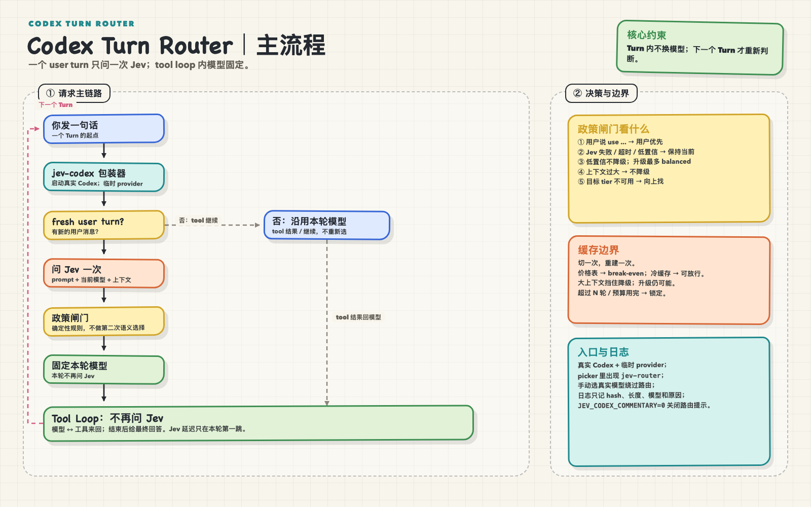
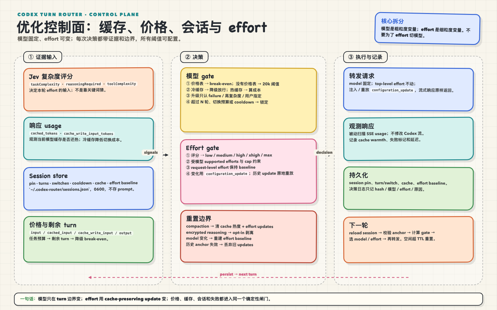
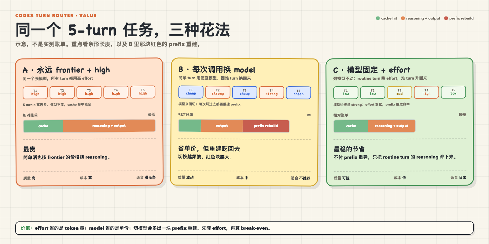

# Jev Auto Router

**[中文](README.md)** | [English](README.en.md)

**Codex 一轮对话，一次模型选择。** `jev-codex` 启动真实的 Codex CLI，在模型选择器里加入虚拟模型 `jev-router`；每个新 user turn 问一次 [TypeSafe Jev](https://docs.typesafe.ai/introduction)，然后把选中的模型固定到这一轮的整个 tool loop。

这是 **turn-pinned Codex router** 的第一版。它优先保证能跑、切换少、缓存友好；旧逐调用路径已经从主入口移除。





控制回路：选 → 闸 → 跑 → 学。

- 使用、配置与设计取舍：[docs/codex-turn-router.md](docs/codex-turn-router.md)
- 测试样本与方法：[docs/evaluation-plan.md](docs/evaluation-plan.md)

## 安装

发布到 npm 后：

```sh
npm install -g jev-auto-router
jev-codex
```

或者不全局安装：

```sh
npx -y jev-auto-router
```

从源码：

```sh
git clone https://github.com/miniLV/Jev-Auto-Router.git
cd Jev-Auto-Router
npm ci
npm run build
npm link
jev-codex
```

## 结果：model list 里多一个 `jev-router`

`jev-codex` 不需要 fork Codex。它启动真实的 Codex CLI，注入一个临时 provider；默认启动时，在 Codex CLI 的 model picker / `/model` 里会多出一个虚拟模型：

```text
jev-router      Jev Router
gpt-6-sol
gpt-6.1-sol
...
```

选中 `jev-router` 才会自动路由；直接选真实模型会绕过路由。这是这个项目最直观的集成结果：**model list 里多一个 entry，而不是一套新的 agent。**

注意：

- 需要 `JEV_API_KEY` / `TYPESAFE_API_KEY`。没有 key 时 `jev-codex` 会启动 Codex 但不启用路由，model list 里不会出现 `jev-router`。
- 当前只覆盖 **Codex CLI**。Codex app 还没有接入这个 wrapper；如果 app 支持自定义 provider，理论上可以指向本地代理，但未验证、未文档化。
- 实际列表取决于你的账号目录；上面的模型名是示意，不是固定阵容。

## 为什么是 turn，而不是每次 model call

```text
Session
└─ Turn：你发一句话 -> 最终回答
   ├─ Model Call 1
   ├─ Tool Call / Tool Result
   ├─ Model Call 2
   └─ ...
```

- **Model Call**：模型被请求一次。工具结果回来后再请求一次，就是新的 Model Call。
- **Tool Loop**：模型 → 工具 → 模型 的来回。
- **Turn**：你发一句话，到它最后答完。

每次切模型都会让新模型重建 prompt prefix。把决策放在 turn 开头、把模型固定在 tool loop 内，能把切换成本压到“每个 user turn 最多一次”，也避免模型在任务中途反复变化。

模型固定之后，effort 可以独立调整：用 `configuration_update` 改变思考档位，保持 request-level effort 不变，并把历史 update 原地重放。当前实现是 **per-turn effort**，不是 per-step；这样不需要额外的逐调用分类器，也不会为了 effort 切模型。

## 价值：先降 effort，再降 model

同一个 5-turn 任务，三种花法：

- **A**：永远 frontier + high，最贵；
- **B**：每次调用换 model，省单价，但多出一块 prefix 重建；
- **C**：模型固定、按 turn 调 effort，cache 保留，routine turn 少烧 reasoning。



这是示意，不是实测账单。真实收益取决于 cache 命中率、output/reasoning 占比和质量。它解释了这个项目最核心的取舍：**effort 是第一杠杆，模型切换要等 break-even。**

> [!WARNING]
> Alpha：effort routing 默认关闭，且 `configuration_update` 的实机 cache 行为还没有在真实 Codex + GPT 会话中验证。先设 `JEV_CODEX_EFFORT_ROUTING=turn` 做一次小任务 smoke，再长期开启。

## 快速开始

需要 Node.js 22+、已登录的 Codex CLI、TypeSafe Jev key。

```sh
npm ci
npm run build
export JEV_API_KEY="<your-typesafe-jev-key>"
node bin/jev-codex.mjs
```

也可以：

```sh
npm run codex      # 构建并启动包装器
npm link && jev-codex
```

所有参数原样转交给 Codex：

```sh
jev-codex resume --last
jev-codex exec "fix the failing test"
```

没有 `JEV_API_KEY` 时，`jev-codex` 会正常启动 Codex，只是不启用路由。

## 一轮里发生什么

```text
你发一句话
  -> jev-codex 包装器启动真实 Codex，注入临时 provider
  -> 代理识别 fresh user turn
  -> 问 Jev 一次：prompt + 当前模型 + 上下文大小 + 候选模型
  -> 政策闸门：用户指定 / 低置信 / 不可用 / 价格 break-even / 稳定保护
  -> 固定本轮模型 + 选择 effort
  -> effort 用 configuration_update；模型不变
  -> tool loop 全部复用该模型，不再问 Jev
  -> 下一个 user turn 再判断
```

用户显式选择具体模型时，请求原样透传，暂停自动路由；重新选择 `jev-router` 恢复。

## 政策

- 用户说 `use <tier>` / `use <model>`：用户优先。
- Jev 失败、超时、答案非法或低置信：保持当前模型。
- 低置信不降级；升级最多到 balanced。
- 上下文超过阈值时，拒绝降级；升级仍可能。阈值是启发式，两个方向都要重建缓存。
- 会话稳定保护：超过 12 个 fresh turn 后停止自动切换；每次切换后至少稳定 1 个 turn；可选切换次数上限。
- 会话空闲超过 30 分钟后，稳定保护重置；模型仍保持，但下一轮可以重新评估。
- 配了价格表时，降级改算 break-even；没配价格表才回退到固定上下文阈值。
- 缓存热度从响应 usage 观测；冷缓存时降级可以绕过重建门槛。
- 升级默认需要触发条件：近期失败、Jev 高复杂度信号，或用户显式指定。
- 目标 tier 不可用：升到最近的可用 tier。
- long tier 默认关闭，需要 `JEV_CODEX_ALLOW_LONG=1`。
- 用户显式 `use ...` 永远绕过上述稳定保护。

## 配置

完整配置见 [docs/codex-turn-router.md](docs/codex-turn-router.md)。

| 变量 | 默认值 | 作用 |
| --- | --- | --- |
| `JEV_API_KEY` / `TYPESAFE_API_KEY` | 路由时必填 | Jev 密钥 |
| `JEV_MODEL` | `jev-1.13.0` | Jev 模型 |
| `JEV_CODEX_FAST_MODEL` | `gpt-6-luna` | fast tier |
| `JEV_CODEX_BALANCED_MODEL` | `gpt-6-sol` | balanced tier |
| `JEV_CODEX_STRONG_MODEL` | `gpt-6.1-sol` | strong tier |
| `JEV_CODEX_LONG_MODEL` | `gpt-6-astra` | long tier（默认关闭） |
| `JEV_CODEX_DOWNGRADE_MAX_CONTEXT_TOKENS` | `20000` | 大上下文降级闸门 |
| `JEV_CODEX_LOCK_AFTER_TURNS` | `12` | 超过 N 个 turn 后停止自动切换（0 = 关闭） |
| `JEV_CODEX_MAX_SWITCHES` | `0` | 每个 session 最多切换次数（0 = 不限） |
| `JEV_CODEX_SWITCH_COOLDOWN_TURNS` | `1` | 切换后至少稳定几个 turn |
| `JEV_CODEX_CACHE_TTL_MS` | `1800000` | 空闲多久后重置稳定保护 |
| `JEV_CODEX_EFFORT_ROUTING` | `off` | 设为 `turn` 才启用每轮 effort |
| `JEV_CODEX_EFFORT_CAP` | `high` | effort 上限 |
| `JEV_CODEX_EFFORT_FALLBACK` | `high` | 没有评分时的回退档位 |
| `JEV_CODEX_PRICES` | 未设置 | 每个模型的价格 JSON，用于 break-even |
| `JEV_CODEX_TASK_TURN_BUDGET` | `0` | 预估任务总 turn 数（0 = 关闭） |
| `JEV_CODEX_UPGRADE_MODE` | `triggered` | 升级触发模式 |
| `JEV_CODEX_SESSION_FILE` | `~/.codex-router/sessions.json` | 持久化 session pin |
| `JEV_CODEX_STRIP_ENCRYPTED_REASONING` | off | 跨模型时移除 encrypted reasoning |
| `JEV_CODEX_COMMENTARY` | `1` | 在 Codex 中显示路由结果 |
| `JEV_CODEX_LOG_FILE` | `~/.codex-router/decisions.jsonl` | 脱敏决策日志 |

决策日志只保存 prompt hash、长度、模型、tier、置信度、原因、上下文大小和 Jev 分数，不保存 prompt 原文。

## 开发

```sh
npm run typecheck
npm test
npm start          # 只启动代理，便于调试
```

代码结构：

```text
src/codex-router/
├─ cli.ts       启动真实 Codex，注入临时 provider
├─ proxy.ts     /models 注入、turn 识别、模型固定、流式转发
├─ policy.ts    用户覆盖、置信度、可用性、缓存降级闸门
├─ turn.ts      fresh user turn 识别与 conversation key
├─ jev.ts       Jev 请求构造、超时、重试、响应解析
├─ config.ts    tier、环境变量、候选模型
├─ cache.ts     价格 break-even 与动态锁
├─ effort.ts    effort 映射、configuration_update 重放
├─ usage.ts     响应 usage / 缓存热度扫描
├─ session-store.ts  持久化 session pin
├─ log.ts       脱敏 JSONL 决策日志
└─ types.ts     共享类型
```

## 已知边界

- 上下文大小是 input 序列化长度的估算，不包含 tools；阈值是启发式，不是精确 token 数。
- 价格 break-even 需要自己提供价格表；没有价格表时回退到固定上下文阈值。
- session pin 已持久化，但只在本机/本用户生效；跨机器仍会重新判断。
- break-even 使用输出估算和剩余 turn 估算，不是供应商账单。
- encrypted reasoning 清理是 opt-in，压缩行为仍需要实机验证。
- commentary 会修改 Codex 事件流；需要字节级原样转发时设 `JEV_CODEX_COMMENTARY=0`。

## License

[Apache License 2.0](LICENSE)
